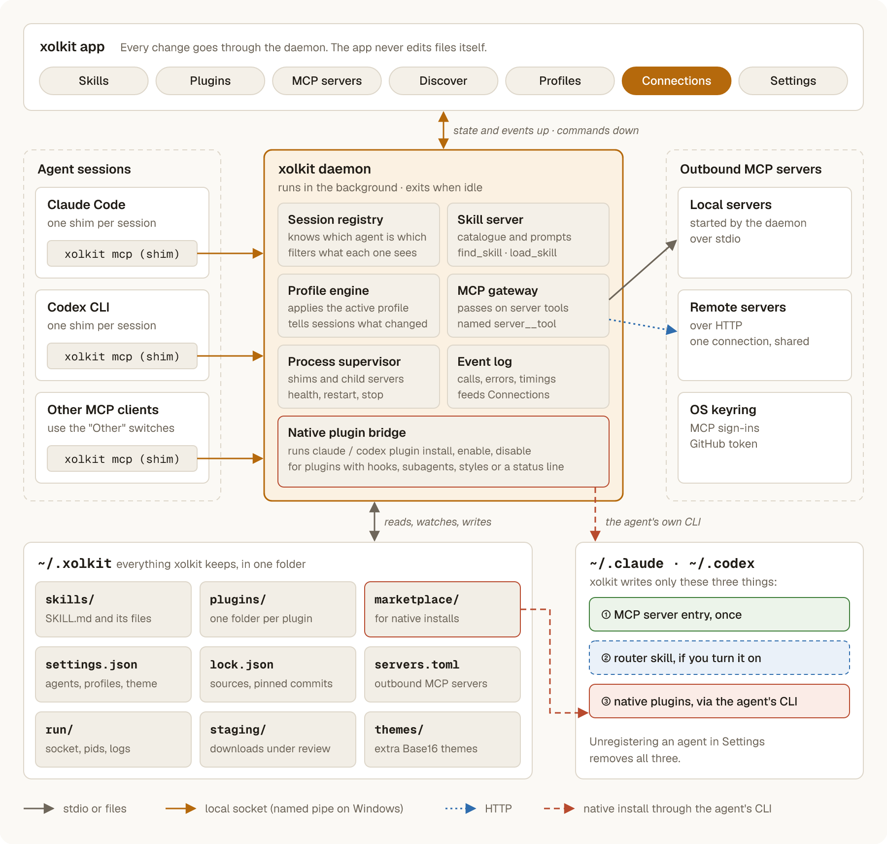

<p align="center">
  <picture>
    <source media="(prefers-color-scheme: dark)" srcset="assets/brand/xolkit-wordmark.svg">
    
  </picture>
</p>

# xolkit

One library of skills, plugins and MCP servers, served to every coding agent you use.

xolkit keeps everything in `~/.xolkit` and serves it to Claude Code, Codex CLI and any other
agent that speaks [MCP](https://modelcontextprotocol.io). You install a skill once. Profiles
decide which agent gets what, and switching profiles takes effect at once, even in sessions
that are already open.

The agents' own folders stay as they are. xolkit adds one MCP server entry to each agent you
register it with, and writes anything else there only when you ask: an optional router skill,
and plugins that only work as native installs.

- **Skills:** find them on [skills.sh](https://skills.sh), install them from GitHub (pinned to a
  commit), or add a folder from your disk. Updates show when a newer commit is out.
- **Plugins:** browse the marketplaces you add and install plugins from them. xolkit serves their
  skills, commands and MCP servers itself, and installs the ones with hooks or subagents in
  the agents natively.
- **MCP servers:** add them once in xolkit. It connects to each one and passes its tools on to
  the agents you turn it on for, so you set up a server once, not in every agent.
- **Profiles:** switch from the title bar. Share one as a code, a `xolkit://` link or a
  `.xolkit` file.
- **Connections:** see every agent session, every MCP server and the processes behind them.
- Updates itself from [GitHub releases](https://github.com/xolan/xolkit/releases).

> **Install only what you trust.** Skills and plugins are instructions and code your agents
> follow and run. xolkit downloads, unpacks and installs them as they are, as with any software
> you install, so take them only from repositories and people you trust.

Runs on Linux and Windows. There is no macOS build.

<picture>
  <source media="(prefers-color-scheme: dark)" srcset="assets/design/architecture.png">
  
</picture>

## How it works

Each agent session starts a small `xolkit mcp` process, the shim. The shim connects to the
xolkit daemon over a socket only you can open, starting the daemon first when it isn't running.
The daemon serves the session, connects to MCP servers, runs the changes the app asks for, and
keeps a log. The app is a window onto the daemon: it reads `~/.xolkit`, and every change it
makes goes through the daemon. The one exception is `~/.xolkit/staging`, where the app puts
downloads while you review them.

A session that stays quiet (10 minutes by default; Settings → Daemon) lets go of the daemon,
and its shim connects again with the agent's next message, so an agent never notices. Once
every session is idle and the app is closed, the daemon exits and stops its MCP servers. A shim
exits when its agent does, even if something else still holds its input open.

How a skill reaches an agent:

1. You start a Claude Code session. Claude Code starts `xolkit mcp`, which tells the daemon it
   serves Claude Code.
2. The daemon answers with instructions listing the skills the active profile has on for Claude
   Code: each skill's name and first sentence, as many as fit, then names only. Each skill is
   also a prompt, which Claude Code shows as `/mcp__xolkit__<skill>`.
3. You ask for something a skill covers. Claude spots it in the list, or searches every skill
   on with the `find_skill` tool.
4. Claude calls `load_skill`. It gets the skill's instructions and the path of its folder, and
   reads references or runs scripts from there with its own tools.
5. You switch profiles in xolkit. The daemon tells every open session that its tools and
   prompts changed, and the next lookup sees the new set.

### Agents

Under Settings → Agents, **Register** adds xolkit to an agent, with the agent's own tool:
`claude mcp add --scope user xolkit -- <xolkit> mcp --agent claude`, and `codex mcp add` for
Codex. **Unregister** takes out everything xolkit wrote there: that entry, the router skill and
the plugins it installed natively.

Any other agent that speaks MCP can use xolkit too: add a stdio server that runs `xolkit mcp`.
Its sessions get the **Other** switches.

The **router skill** is an optional single `xolkit` skill in an agent's skills folder. Its
description is a digest of what your skills are for, and it tells the agent to use
`find_skill`. Turn it on for an agent that misses skills the MCP instructions list. Agents read
it when a session starts, so changes reach it in new sessions only.

### Plugins

An installed plugin is unpacked into `~/.xolkit/plugins/<name>@<marketplace>`. Its skills,
commands and MCP servers are served like everything else. Hooks, subagents, output styles and
LSP servers only work from an agent's own folders, so a plugin with any of them is also
installed **natively**: xolkit lists it in its local marketplace, `~/.xolkit/marketplace`,
registers that marketplace with the agent once, and installs from it with the agent's own tool
(`claude plugin install`, `codex plugin add`). Profiles turn native plugins on and off there
too. While an agent has a plugin natively, xolkit stops serving that plugin's parts to it, so
nothing shows up twice.

Select a managed plugin to check its marketplace for updated contents. When an update is
available, **Update…** downloads it and shows the steps before installing. Updates refresh
native installs and keep profile switches. Use **Reload** to check again.

### MCP servers

Add a server by the command that starts it or by its URL. xolkit starts local servers itself and
keeps one connection to each remote server, shared by every session. Agents see a server's tools
as `<server>__<tool>`; in Claude Code that reads `mcp__xolkit__github__create_issue`. Servers
you already set up in Claude Code or Codex stay there; **Copy from agents** adds copies to xolkit,
moving their values into the OS keyring.

Remote servers take headers, such as `Authorization: Bearer …`, or a sign-in in a browser
(OAuth). A remote server without secrets that asks for a sign-in shows **needs sign-in**;
**Sign in** on its page opens your browser, and xolkit keeps the tokens in the OS keyring,
renews them, and sends them only to the URL they were given for. **Sign out** forgets them.
xolkit registers itself with the server's sign-in on its own, so servers that need a client ID
set up by hand aren't supported yet.

### Profiles

A profile holds the agents xolkit serves and which skills, plugins and servers are on for each.
Switch from the title bar or the command palette (`Ctrl+K`). The Default profile can't be
removed, and the profile in use keeps whatever you change while it's active. A new skill,
plugin or server is on for the agents of the profile in use, and off in the others.

**Share** gives a code like `xolkit1:eNqtkc1u…`, a `xolkit://import/…` link, or a `.xolkit`
file. A code lists where each skill and plugin comes from, pinned to a commit, and the servers
without their secrets; never file contents. Skills that exist only on your disk can't go in a
code, so share those as a file. **Import** always shows what the profile would install, and from
where, before anything is downloaded, and adds it as a new profile.

## Requirements

- Linux: x86_64 or aarch64 with glibc 2.35 or newer (Ubuntu 22.04, Debian 12, Fedora 36 and
  later), a Wayland or X11 session, and working GPU drivers. Secrets go to the Secret Service, so
  you need a provider such as GNOME Keyring or KeePassXC running.
- Windows: Windows 10 or 11, x64 or Arm64. Secrets go to the Credential Manager.
- [Claude Code](https://docs.claude.com/en/docs/claude-code) (`claude`), [Codex
  CLI](https://github.com/openai/codex) (`codex`), or both, on your `PATH`, for the agents you
  register with. xolkit runs them to register itself and for native plugins.
- Optional: the [GitHub CLI](https://cli.github.com) (`gh`), signed in with `gh auth login`.
  xolkit asks it for a token when it downloads from GitHub. Without it, pick anonymous access
  (60 requests an hour) or save a token under Settings → GitHub access. Private repositories,
  such as a private marketplace, need a token that can read them.
- `tar` on your `PATH`, which xolkit unpacks downloads with. Linux has it, and so do Windows 10
  and 11.

xolkit talks to `skills.sh`, `api.github.com`, `codeload.github.com` and
`raw.githubusercontent.com`, to the MCP servers you add, and downloads its own updates from
`github.com` and `release-assets.githubusercontent.com`.

## Install

Each release holds a Linux tarball and a Windows zip for x86_64 and aarch64, and a `PKGBUILD`
for Arch Linux, each with a `.sha256` checksum file.

### Linux

Download `xolkit-<version>-<arch>-unknown-linux-gnu.tar.gz` and its `.sha256` from
[Releases](https://github.com/xolan/xolkit/releases), where `<arch>` is `x86_64` or `aarch64`
(`uname -m` tells you which). In the folder you downloaded them to, set `version` to the release
you picked and run:

```bash
version=3.2.0
name=xolkit-$version-$(uname -m)-unknown-linux-gnu
sha256sum -c "$name.tar.gz.sha256" &&
  tar -xzf "$name.tar.gz" &&
  install -Dm755 "$name/xolkit" ~/.local/bin/xolkit &&
  install -Dm644 "$name/xolkit.desktop" ~/.local/share/applications/xolkit.desktop &&
  cp -r "$name/icons/." ~/.local/share/icons/ &&
  update-desktop-database ~/.local/share/applications
```

If the checksum doesn't match, nothing is installed. The last command lets `xolkit://` links
open xolkit.

The desktop entry starts `xolkit` from your `PATH`. If it doesn't show in your app menu, or
won't start from there, check that `~/.local/bin` is on the `PATH` of your desktop session, not
only your shell's, and log out and back in.

### Arch Linux

On Arch and other pacman-based distributions, download `PKGBUILD` and `PKGBUILD.sha256` from
[Releases](https://github.com/xolan/xolkit/releases) into an empty folder, and in that folder
run:

```bash
sha256sum -c PKGBUILD.sha256 && makepkg -si
```

Or, in a clone of this repository, run `mise run install`: it downloads the `PKGBUILD` of the
release matching the checked-out version (the latest release if that version isn't released yet),
checks it against `PKGBUILD.sha256`, and runs `makepkg -si` in a temporary folder.

Either way, this builds a `xolkit-bin` package from the release's prebuilt binary, checks the tarball
against the checksum in the `PKGBUILD`, and installs it with pacman, which pulls in the libraries it
needs. If you have no Vulkan driver yet, pacman asks you to pick the one for your GPU, such as
`vulkan-radeon`, `vulkan-intel` or `nvidia-utils`.

If you installed from the tarball before, remove that copy first (the first `rm` command under
[Uninstall](#uninstall)), or the one in `~/.local/bin` keeps starting instead.

### Windows

Download `xolkit-<version>-x86_64-pc-windows-msvc.zip` from
[Releases](https://github.com/xolan/xolkit/releases) (`aarch64` for Arm PCs), extract it
somewhere it can stay, such as `%LOCALAPPDATA%\Programs\xolkit`, and run `xolkit.exe`. To
start it from the Start menu, right-click `xolkit.exe` and choose Pin to Start.

The executable isn't signed yet, so on first launch SmartScreen says "Windows protected your PC":
choose More info, then Run anyway. xolkit registers itself for `xolkit://` links for your user
when it starts.

xolkit finds `claude`, `codex` and `gh` on your `PATH`, including the `.cmd` files npm
installs.

### First run

Open Settings, **Register** xolkit with the agents you use, and turn them on under "Served by
the active profile". Then add skills, plugins and servers. Agent sessions started from then on
connect to xolkit.

### Upgrading from 2.x

3.0 starts fresh: it doesn't read or move anything 2.x installed. Skills in `~/.agents/skills`,
the links 2.x made in `~/.claude/skills`, and plugins the agents installed stay where they are.
Add what you want to keep to xolkit again, and remove the old copies with `npx skills` or the
agents' own tools. 2.x kept its settings in `~/.config/xolkit` (`%APPDATA%\xolkit` on Windows),
which you can delete.

## Where it keeps its files

Everything is in `~/.xolkit` (`%USERPROFILE%\.xolkit` on Windows), or `$XOLKIT_HOME` if you
set it:

| File | What it holds |
| --- | --- |
| `skills/` | Installed skills, one folder each |
| `plugins/` | Installed plugins, one folder each |
| `marketplace/` | The local marketplace agents install native plugins from |
| `settings.json` | Profiles, the profile in use, marketplaces, theme and other choices |
| `lock.json` | Where each skill and plugin came from, pinned to a commit, and which agents have a plugin natively |
| `servers.toml` | The MCP servers xolkit connects to |
| `run/` | The daemon's socket, pid file and log |
| `staging/` | Downloads under review; ones over an hour old are cleared when the app starts |
| `themes/` | Extra Base16 themes you add |

Tokens and other secrets are in the OS keyring, never in `~/.xolkit`, so the folder is safe to
back up or keep in a dotfiles repository.

In the agents' folders, xolkit writes only:

- the `xolkit` MCP server entry, through `claude mcp add` (into `~/.claude.json`) and
  `codex mcp add` (into `~/.codex/config.toml`);
- the router skill, `~/.claude/skills/xolkit` and `~/.codex/skills/xolkit`, when you turn it on;
- native plugins, through the agents' own plugin commands, and Codex's `[plugins]` switches for
  them in `~/.codex/config.toml`.

`$CLAUDE_CONFIG_DIR` and `$CODEX_HOME` move `~/.claude` and `~/.codex`, as they do for the agents.

## Command line

| Command | What it does |
| --- | --- |
| `xolkit` | Open the app |
| `xolkit xolkit://import/…` | Open the app to import a shared profile |
| `xolkit mcp [--agent claude\|codex\|other]` | Serve an agent session over stdio; agents run this |
| `xolkit daemon` | Run the daemon; xolkit starts it itself when needed |
| `xolkit status` | Print what the daemon reports (sessions, servers, recent events) as JSON |

## Uninstall

First, in Settings → Agents, **Unregister** xolkit from each agent, which takes out everything it
wrote there.

On Linux, if you installed the Arch package, run `sudo pacman -R xolkit-bin` in place of the
first `rm` command, which removes the binary, desktop entry and icons:

```bash
rm ~/.local/bin/xolkit \
  ~/.local/share/applications/xolkit.desktop \
  ~/.local/share/icons/hicolor/*/apps/xolkit.svg
rm -rf ~/.xolkit   # the library, settings and the daemon's files
```

On Windows, delete the folder you extracted (an update may leave `xolkit.exe.old` in it), unpin
it from Start, delete `%USERPROFILE%\.xolkit`, and delete the `HKEY_CURRENT_USER\Software\Classes\xolkit`
registry key that handles `xolkit://` links.

xolkit's secrets stay in the OS keyring under the service name `xolkit`; remove them with your
keyring's own tool (Seahorse, KeePassXC, or the Windows Credential Manager).

## Keyboard

| Key | What it does |
| --- | --- |
| `Ctrl+K` | Command palette: go to a page, reload, switch profile, pick a theme |
| `Up` / `Down` | Move through the list, also from the filter field |
| `Enter` | Install the selected search result, update the selected skill or plugin, edit the selected server, or switch to the selected profile |
| `Delete` | Remove the selected skill, plugin or server, unless the filter field has focus |
| `Ctrl+F` | Focus the filter |
| `Ctrl+R` | Reload |
| `Ctrl+Q` | Quit |

## Themes

xolkit ships its own light and dark themes and a set of Base16 schemes. Drop more Base16
scheme files (`*.yaml`) into `~/.xolkit/themes` and pick them under Settings → Theme, or from
the command palette (`Ctrl+K`).

The UI font is [Geist](https://github.com/vercel/geist-font), embedded under the SIL Open Font
License (`OFL-Geist.txt` in the release archive).

## Development

Tooling is pinned in `mise.toml`: Rust 1.99.1 with rustfmt and clippy, and actionlint. Run every
developer command through [mise](https://mise.jdx.dev); you don't need rustup.

You also need:

- Git and Python 3 (the licenses check in `mise run ci` uses it).
- On Linux, a C toolchain and these libraries. On Debian or Ubuntu:

  ```bash
  sudo apt-get install -y build-essential libfontconfig-dev libwayland-dev libxkbcommon-x11-dev libx11-xcb-dev
  ```

  On other distributions, install the development packages for fontconfig, wayland,
  libxkbcommon-x11 and libx11-xcb.
- On Windows, the Visual Studio Build Tools with the "Desktop development with C++" workload and a
  Windows SDK (gpui compiles its shaders with the SDK's `fxc.exe`), and Git for Windows (mise runs
  the bash tasks with its bash).

Then:

```bash
git clone https://github.com/xolan/xolkit.git
cd xolkit
mise trust
mise install
mise run run
```

The workspace has three crates: `xolkit-core` (the library in `~/.xolkit` and the changes to
it), `xolkit-daemon` (the daemon, the shim and the app's client for it, on
[rmcp](https://github.com/modelcontextprotocol/rust-sdk)), and `xolkit` (the app and the
command line).

| Command | What it does |
| --- | --- |
| `mise run run` | Run the app |
| `mise run test` | Run the tests |
| `mise run lint` | Check formatting, clippy and the GitHub workflows |
| `mise run ci` | Lint, tests and the licenses check, as CI runs them |
| `mise run fmt` | Format the code |
| `mise run build` | Build a release binary |
| `mise run install` | Install xolkit from the release matching the checked-out version with `makepkg -si` (Arch Linux and other pacman-based distributions) |
| `mise run package <target>` | Build a release archive into `dist/` for the host's own platform: a tarball on Linux, a zip on Windows |
| `mise run licenses` | Regenerate `THIRD_PARTY_LICENSES.md` and the app's `licenses.json` after changing dependencies |
| `mise run icon` | Render the Windows app icon from the SVGs in `assets/brand/` |
| `mise run diagram` | Redraw the architecture diagram in `assets/design/` (needs [resvg](https://github.com/linebender/resvg)) |

The daemon's end-to-end test runs a real daemon in a throwaway home with a small MCP server it
passes on. A few tests call skills.sh and GitHub, so they are skipped by default. Run them with
`mise exec -- cargo test -p xolkit-core --locked -- --ignored`.

To try xolkit without touching your own setup, point it at throwaway folders:
`XOLKIT_HOME=/tmp/x/.xolkit CLAUDE_CONFIG_DIR=/tmp/x/claude CODEX_HOME=/tmp/x/codex mise run run`.

## Contributing

Issues and pull requests are welcome. Before you open a pull request, run `mise run ci`, and run
`mise run licenses` if you changed dependencies. Leave the version in `Cargo.toml` alone: a new
version on `main` publishes a release.

## Releases

Pushing to `main` with a new `version` in `Cargo.toml` runs CI, builds Linux and Windows binaries
(x86_64 and aarch64), writes the Arch Linux `PKGBUILD` from `assets/arch/PKGBUILD` with the
tarballs' checksums, and publishes a GitHub release `v<version>`.

## License

[MIT](LICENSE). Third-party crates, fonts, icons and color schemes are credited in
[THIRD_PARTY_LICENSES.md](THIRD_PARTY_LICENSES.md), also shown in the app under Settings → Third-party licenses.
